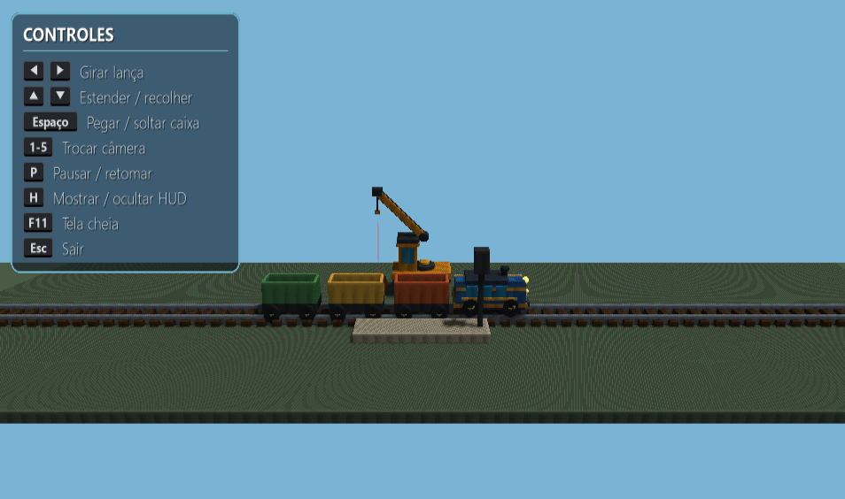

# Trem de carga

Projeto de Computação Gráfica em Python com PyGame e OpenGL moderno (shaders GLSL): um trem de carga que percorre um trilho e para em uma estação, enquanto o usuário opera um guindaste móvel para carregar caixas nos vagões.

## 1. Identificação

**Disciplina:** Computação Gráfica
**Instituição** UNIPAC
**Professor(a):** Rodrigo Fernandes dos Santos

### Integrantes

| Nome | Matrícula |
|------|-----------|
| `Pedro Henrique Ramos de Carvalho` | `[241-006947]` |
| `Victor Hugo Silva de Assis` | `[242-000228]` |


### Temas sorteados

- Tema 1: `Trem de um Vagão`
- Tema 2: `Guindaste móvel`

## 2. Descrição da cena e da interação



### Cena

Uma composição ferroviária com uma locomotiva principal e três vagões de carga com carroceria aberta, interior livre e rodas, para que as caixas fiquem visíveis dentro deles. O trilho reto tem 40 unidades e atravessa a cena de uma ponta a outra da janela.

Um guindaste móvel fica do lado oposto da estação, com rodas, cabine, braço telescópico e gancho interativo. Sinais e faróis têm brilho próprio (emissivo), e o chão recebe a sombra projetada dos objetos.

### Animação

- Cada um dos três vagões para alinhado com a estação enquanto aguarda o carregamento manual; entre paradas, o trem avança o espaçamento entre vagões.
- A locomotiva acompanha o primeiro vagão, que aguarda a caixa antes de o trem continuar.
- Depois de atravessar o trilho, a animação encerra o programa.
- O deslocamento é controlado por `delta_time` (independente da taxa de quadros) e a rotação das rodas acompanha a distância percorrida.

### Interação

1. Use as setas para posicionar o gancho sobre qualquer uma das três caixas, em qualquer ordem.
2. Pressione `Espaço` para pegá-la.
3. Com a caixa suspensa, mova o guindaste até o vagão parado e pressione `Espaço` novamente para baixá-la.
4. Para carregar um vagão, use a caixa da mesma cor; uma caixa de outra cor não é solta dentro dele.
5. O trem aguarda o carregamento manual antes de continuar.

A linha vermelha indica a posição vertical de mira do gancho.

## 3. Conteúdo da entrega

| Item | Local |
|------|-------|
| Código-fonte | `main.py` e pasta `train_scene/` |
| Rotinas gráficas implementadas no projeto | `train_scene/math3d.py`, `geometry.py`, `scene.py`, `camera.py` (ver seção 8) |
| Shaders | `train_scene/shaders.py` |
| Texturas | Gerada no programa (ver seção 7); não há arquivos de imagem externos |
| Testes | Pasta `tests/` |
| Dependências | `requirements.txt` |
| Documentação | Este `README.md` |

## 4. Instalação e execução

Requer Python 3 e uma GPU/driver com suporte a OpenGL.

```powershell
py -m pip install -r requirements.txt
py -m unittest discover -s tests -v
py main.py
```

No Python 3.14 não há wheel disponível para `pygame`; por isso, o `requirements.txt` instala `pygame-ce` nessa versão, que fornece o mesmo `import pygame`.

O mesmo ponto de entrada também pode ser executado com `python -m train_scene`.

### Verificações

- `python main.py --self-test`: valida o trilho reto, o movimento independente da taxa de quadros, a pausa e a espera pelo carregamento manual, sem abrir janela.
- `python main.py --smoke-test`: inicializa o contexto OpenGL, compila os shaders, cria o framebuffer de sombra e renderiza um quadro antes de sair.
- `py -m unittest discover -s tests -v`: executa os testes automatizados da animação, carregamento, câmera, guindaste e HUD.

Execute o comando a partir da raiz do projeto. A opção `-s tests` é
necessária: sem ela, `unittest` pode não entrar na pasta `tests/` e reportar
`Ran 0 tests`. Use o mesmo interpretador Python para instalar as dependências
e executar os testes.

#### PyCharm

Se as classes de teste não aparecerem ou não iniciarem, confira o interpretador
do projeto em **Settings > Project > Python Interpreter**. Selecione um Python
instalado ou crie um ambiente virtual `.venv` dentro deste repositório; depois
instale nele as dependências de `requirements.txt`. Um caminho de interpretador
salvo por outra máquina ou projeto pode não existir no seu computador.

## 5. Controles

As instruções também ficam visíveis no canto superior esquerdo da janela.

| Tecla | Ação |
|-------|------|
| `1` | Câmera de frente |
| `2` | Câmera de trás |
| `3` | Câmera da direita |
| `4` | Câmera da esquerda |
| `5` | Visão superior |
| `←` / `→` | Girar a lança do guindaste |
| `↑` / `↓` | Estender / recolher a lança |
| `Espaço` | Pegar uma caixa ao alcance; com a caixa suspensa, descer e soltar |
| `P` | Pausar / retomar; não reinicia o jogo |
| `H` | Mostrar / recolher o painel de controles |
| `F11` | Alternar entre modo janela e tela cheia |
| `Esc` | Sair |

O painel é exibido no canto superior esquerdo ao iniciar e se recolhe
automaticamente após cinco segundos. Quando recolhido, permanece a dica
`[H] Controles`; pressione `H` para reabri-lo. O painel também pode ser
recolhido ou reaberto manualmente, e o contador de recolhimento reinicia ao
reabrir. Ao pausar com `P`, a indicação `PAUSADO` aparece no topo central.
O tempo do HUD continua avançando mesmo durante a pausa da animação.

## 6. Organização do código

```text
main.py                 ponto de entrada compatível
train_scene/
  app.py                inicialização, loop e autoteste
  animation.py          movimento, paradas e carga
  camera.py             câmera e controles
  geometry.py           malhas e geometria estática
  math3d.py             transformações e matrizes
  scene.py              recursos OpenGL e orquestração da renderização
  settings.py           dimensões e constantes da cena
  shaders.py            shaders GLSL
  hud.py                shaders, textura e desenho do painel de controles
  train_parts.py        composição visual do trem e dos vagões
  crane_parts.py        composição visual do guindaste e das caixas
tests/
  test_animation.py     testes da lógica temporal e carregamento
  test_camera.py        testes das vistas da câmera
  test_crane.py         testes dos controles e da interação do guindaste
  test_hud.py           testes do toggle e do recolhimento automático do HUD
```

## 7. Recursos gráficos implementados

A tabela identifica os principais shaders, atributos, uniforms e as classes e
funções que implementam os recursos gráficos.

| Recurso gráfico | Arquivo | Classe / função |
|-----------------|---------|-----------------|
| Vertex shader e fragment shader principais | `train_scene/shaders.py` | `VERTEX_SHADER`, `FRAGMENT_SHADER` |
| Shaders de profundidade da luz (shadow pass) | `train_scene/shaders.py` | `DEPTH_VERTEX_SHADER`, `DEPTH_FRAGMENT_SHADER` |
| Shaders do HUD | `train_scene/hud.py` | `HUD_VERTEX_SHADER`, `HUD_FRAGMENT_SHADER`; classe `ControlsHud` |
| VBO intercalado (posição, normal, UV) | `train_scene/geometry.py` | `Mesh.__init__` |
| Transformações hierárquicas | `train_scene/math3d.py`, `train_parts.py`, `crane_parts.py` | `translation`, `scale_matrix`, `rotation_x/y/z`; `TrainPartsBuilder.build`, `CranePartsBuilder.build` |
| Câmera e projeção em perspectiva | `train_scene/camera.py`, `scene.py`, `math3d.py` | `Camera.set_view`, `Camera.view_matrix`, `Scene._render_scene_pass`, `perspective` |
| Transformação das normais (inclusive sob escala não uniforme) | `train_scene/shaders.py` | expressão `mat3(transpose(inverse(uModel)))` em `VERTEX_SHADER` |
| Iluminação direcional difusa e especular | `train_scene/shaders.py` | `main` em `FRAGMENT_SHADER` |
| Textura procedural RGBA e UVs | `train_scene/scene.py`, `train_scene/geometry.py` | `create_train_texture`; UVs em `make_cube`, `make_cylinder`, `make_sphere` |
| Shadow mapping (framebuffer da luz, PCF 3x3, bias) | `train_scene/scene.py`, `train_scene/shaders.py` | `make_shadow_target`, `Scene._render_shadow_pass`, `Scene._render_scene_pass`, `shadowAmount` |
| Transparência da linha de mira (`uAlpha`) | `train_scene/scene.py`, `train_scene/shaders.py` | `Scene._draw_aim_line`, uniform `uAlpha` em `FRAGMENT_SHADER` |
| Emissivo para sinais e faróis (`uEmissive`) | `train_scene/scene.py`, `train_scene/shaders.py` | `Scene._scene_parts`, `TrainPartsBuilder.build`, uniform `uEmissive` em `FRAGMENT_SHADER` |
| Modelos do trem e dos vagões | `train_scene/train_parts.py` | `TrainPartsBuilder.build` |
| Modelos do guindaste e das caixas | `train_scene/crane_parts.py` | `CranePartsBuilder.build` |
| Animação por `delta_time`, paradas e carga | `train_scene/animation.py`, `train_scene/crane.py` | `TrainState.update`, `TrainState.load_current_wagon`, `CraneController.update`, `CraneController._advance_action` |
| HUD com painel, dica e aviso de pausa | `train_scene/hud.py`, `train_scene/scene.py` | `ControlsHud.draw`, `Scene.render` |
| Alternância do HUD pela tecla `H` | `train_scene/app.py`, `train_scene/hud.py` | evento `pygame.K_h`, `ControlsHud.toggle` |

### Shaders, atributos e uniforms

`train_scene/shaders.py` contém o vertex shader e o fragment shader principal, além do par mínimo usado na passagem de profundidade da luz. As malhas da cena usam um VBO intercalado: `aPosition` (location 0, posição local), `aNormal` (location 1, normal local) e `aTexCoord` (location 2, coordenadas UV). A matriz normal transforma as normais para o espaço do mundo, inclusive sob escala não uniforme.

No shader principal:

- `uModel`, `uView` e `uProjection` aplicam as transformações hierárquicas, a câmera e a projeção em perspectiva.
- `uLightSpace` projeta a cena do ponto de vista da luz.
- `uLightDirection`, `uCameraPosition`, `uShininess` e `uBaseColor` controlam a iluminação direcional e o material.
- `uColorTexture` e `uUseTexture` controlam a textura.
- `uShadowMap` fornece a profundidade da luz.
- `uEmissive` destaca os sinais e os faróis.
- `uAlpha` controla a transparência da linha de mira.

O depth shader usa `aPosition`, `uModel` e `uLightSpace` para gravar a profundidade dos objetos no mapa de sombra. O HUD possui shaders próprios: `aPosition` e `aTexCoord` são atributos 2D,
`uPanel` seleciona a textura do elemento desenhado e `uAlpha` controla o fade
entre o painel e a dica recolhida.

### Texturas

A textura azul/dourada do vagão é uma imagem RGBA gerada no próprio programa, com UVs definidos por face. Não há imagem externa. O painel de controles do HUD também é gerado em tempo de execução.

### Sombras

O shadow mapping tem duas passagens: primeiro, o depth shader grava a profundidade da cena no framebuffer da luz; depois, o fragment shader compara a profundidade projetada de cada fragmento com esse mapa, usando PCF 3x3 e bias para suavizar bordas e reduzir acne. A sombra é a região projetada/escurecida sobre o chão; não é o mesmo que o sombreamento difuso/especular, que calcula a aparência iluminada das superfícies usando as normais.

## 8. Framework da obra e componentes gráficos

O projeto **não utiliza o framework nem exemplos de código do livro**. As
rotinas gráficas abaixo foram implementadas pela equipe em PyGame/PyOpenGL:

- `math3d.py`: matrizes e transformações.
- `geometry.py`: malhas de cubo, cilindro e esfera, com configuração de VBO/VAO.
- `scene.py` e `hud.py`: shaders, texturas, framebuffer de sombra e renderização.
- `camera.py`: câmera e controles.

Os modelos são composições próprias de cubos, cilindros e esferas; não foram reutilizados modelos externos.

Como o enunciado menciona o framework da obra, esta implementação própria deve
ser confirmada com o professor. Não listamos o livro como fonte porque ele não
foi consultado nem utilizado no desenvolvimento.

## 9. Contribuições individuais


| Integrante | Contribuições realizadas (arquivos, classes ou tarefas) |
|------------|----------------------------------------------------------|
| Pedro Henrique Ramos de Carvalho | Refatoração do código e ajustes finais da entrega |
| Victor Hugo Silva de Assis | Elaboração do projeto, estruturação do código e implementação das funcionalidades |

## 10. Uso de inteligência artificial


| Ferramenta | Finalidade | Trechos desenvolvidos ou revisados |
|------------|------------|------------------------------------|
| Copilot | Revisão de código, geração de testes e redação do README  | `README.md`, `tests/` e trechos de código revisados pelo grupo |
| Copilot (SDK no VS Code) | Conferência do atendimento ao enunciado e atualização da documentação do HUD | `README.md`, especialmente as seções 3 a 7 |


## 11. Fontes consultadas

- Material da disciplina `Computação Gráfica - Desenhando Formas com preenchimento.pdf`: atributos de vértice e comunicação entre vertex shader e fragment shader.
- `2026 - Computação Gráfica - Trabalhando Texturas.pdf`: uso de textura e coordenadas UV.
- `Visão - Computação Gráfica.pdf`, `2026 - Computação Gráfica - Aulas 05 e 06.pdf` e `_2026 - Computação Gráfica - Aulas 07 e 08.pdf`: materiais de visão, transformações e pipeline da disciplina.
- Documentação oficial do Pygame/pygame-ce e do PyOpenGL.